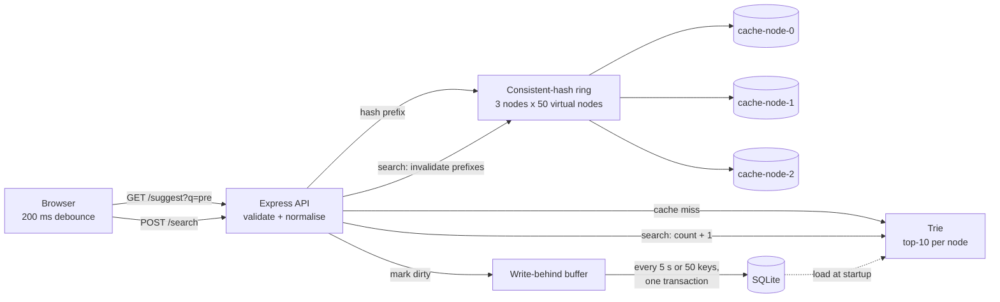

# Aura Search: search-as-you-type with a top-K trie

A search typeahead (autocomplete) service, built to work through the design of search-as-you-type end to end. As the user types, the server returns the 10 best completions for the current prefix, ranked either by all-time popularity or by a "trending" score that favours recent searches.

It is a single Node.js process. Inside it:

- a **radix (path-compressed) trie with sorted child arrays and a precomputed top-10 list on every node**, so a lookup is a walk of the prefix and nothing else. The original 37-slot array trie is kept as a baseline, see [Radix trie instead of a 37-slot array](#radix-trie-instead-of-a-37-slot-array)
- a **consistent-hash ring with virtual nodes** that routes each prefix to one of three cache nodes. These are simulated in the same process, see [Why the ring is simulated in-process](#why-the-ring-is-simulated-in-process)
- a **write-behind buffer** that collects search counts in memory and writes them to SQLite in one transaction every 5 s or every 50 distinct queries
- a React dashboard showing suggestions, cache routing and live metrics


Demo video: [Google Drive](https://drive.google.com/file/d/1GvSiU5mmyKdcor3O8vR-i3xQLK5v7aIT/view?usp=sharing)

---

## 1. Problem

Typeahead has to answer on every keystroke, so reads outnumber writes by a large factor and each read has a tight budget (tens of milliseconds end to end, including the network). The data has a long tail: a few queries get most of the traffic (Zipf distribution). Results should also respond to what people are searching right now, not only to all-time totals.

That leads to three choices:
1. Precompute the answer for every prefix so a read does no sorting.
2. Cache hot prefixes in front of the trie.
3. Take the database off the request path for writes.

## 2. Architecture



All boxes run in one Node.js process. The cache nodes are three `Map`s behind a real hash ring.

### Read path: `GET /suggest?q=<prefix>&mode=trending|basic`

1. The browser debounces keystrokes for 200 ms, then sends the prefix.
2. The server validates and normalises it: lowercase, characters outside `a-z 0-9` become a space, repeated spaces collapse, at most 100 characters. One trailing space is kept, because `"iphone "` (word finished) should not suggest `"iphones"`.
3. If the clock has moved into a new hour, trending scores are recomputed first (see [Trending score](#trending-score)).
4. The prefix is hashed (MD5, first 32 bits) onto the ring. The next virtual node clockwise picks the cache node.
5. Cache hit: return the stored list. Cache miss: walk the trie, take that node's precomputed top-10, store a copy in the cache with a 10 s TTL and return it.

### Write path: `POST /search {"query": "..."}`

1. Normalise the query and reject it if it is empty, only punctuation or over 100 characters.
2. Read the current count and hourly buckets from the trie (O(L)), add 1, and re-insert. This updates the top-10 lists on every node along the path.
3. Delete the cached lists for every prefix of the query (`""`, `"p"`, `"pa"`, ...), so the next keystroke sees the new count.
4. Add the query to the buffer's dirty set and return 200. SQLite is not touched on this request.
5. The buffer flushes when 50 distinct queries are waiting or every 5 s. A flush writes, in one transaction, the current all-time count and the hourly buckets of each dirty query, read from the trie. 1,000 searches for the same query between two flushes become one row write.

## 3. Design decisions and trade-offs

### Precomputed top-K on every node (memory for latency)

| | Plain trie | This trie |
|---|---|---|
| Lookup | walk L chars, then visit the whole subtree and sort it | walk L chars, return the stored list |
| Lookup cost | O(L + subtree size · log) (a 1-letter prefix touches a large share of the data) | O(L + K) |
| Insert / increment | O(L) | O(L · K log K): every node on the path re-sorts its list of at most K+1 entries |
| Memory | one node per character | plus two lists of up to K entries (basic and trending) per node |

K = 10. Reads are far more frequent than writes in typeahead, so moving the sorting to the write path is the right trade.

The lists stay correct because counts only go up between rebuilds. A query that was pushed out of a node's top 10 can only come back by being searched again, and that search re-inserts it. If counts could go down, a node would need its 11th-best entry, which it no longer stores. Scores do go down when the hour changes, and that is why the whole trie is rebuilt then. `tests/trie-property.test.ts` checks every prefix against a brute-force sort on random data, before and after an hour change.

### Radix trie instead of a 37-slot array

The first version (`src/trie-array.ts`, class `ArrayTrie`) used one node per character, and each node had `children = new Array(37)`: slots 0-25 for `a-z`, 26-35 for `0-9`, 36 for space. A child lookup was an array index, but every node paid for 37 slots even though most deep nodes have one child. Measured: 4,850,630 nodes and 4,394 MiB of heap for 1M terms (`bench/results/trie-bench-full.json`).

The current trie (`src/trie-radix.ts`, class `RadixTrie`, the default) changes three things. The estimate behind them is in [docs/MEMORY_V3.md](docs/MEMORY_V3.md).

- **Path compression.** A node stores the edge label that leads to it, so a run of single-child nodes is one node. Nodes remain only where a query ends or two queries diverge. For the seeded data set, 100k terms need 131,876 nodes instead of 558,714, and 1M terms need 1,396,994 instead of 4,850,630 (`bench/trie-shape.ts`, output in `bench/results/trie-shape.json`).
- **Sorted child arrays.** Children are a small array sorted by the first character of their label (binary search), allocated only on nodes that have children.
- **One entry object per query.** Every list that contains a query points at the same `{query, count, score}` object, instead of each node keeping its own copy.

The top-10 lists are unchanged: both modes, on every node, same ordering and tie-break. A prefix that ends in the middle of an edge uses the list of the node at the end of that edge, which is correct because every stored query under that point passes through that node.

Select the implementation with `TRIE_IMPL=radix` (default) or `TRIE_IMPL=array`. The methods of `Trie` are unchanged; `root` is now opaque (typed `object`). `tests/trie-impls.test.ts` runs the same brute-force comparison against both.

Like the array trie, this index covers only `a-z`, `0-9` and space, so every input goes through `normalizeQuery()`. Before that, punctuation was mapped to the space slot while the original text was kept, so `"c++"` and `"c--"` ended at the same node and overwrote each other's counts (fixed in v2.0.0). Non-ASCII letters are dropped. A real system would transliterate them first.

Trade-offs of the radix trie:

- **Insert has more cases.** A new query can split an edge, and each step does a binary search and a label comparison.
- **Each lookup step does more work.** A step is a binary search over at most 37 children plus a label comparison, where the array trie did one index. A lookup visits fewer nodes. The measured lookup change is in [Benchmarks](#6-benchmarks).
- **The code is harder to read** than the array trie, which is one reason the array version is kept and tested beside it.

### Trending score

```
score = 10 × (searches this hour) + 5 × (searches previous hour) + 0.05 × (all-time searches)
```

Counts are kept per hour bucket (`hour_timestamp → count`). This is a step decay, not an exponential one: a search is worth 10 in its own hour, 5 in the next, and only its all-time weight after that. Scores change only when the hour changes. The first request in a new hour therefore calls `Trie.refreshScores()`, which rebuilds the trie from its own entries (not from SQLite, so buffered searches are kept), drops buckets older than the previous hour, and clears the cache. This is synchronous: about one rebuild per hour, during which the event loop is busy for the build time shown in the benchmarks.

### Write-behind buffer: durability window

- **Gain:** a search returns without waiting for disk, and repeated searches for the same query collapse into one write per flush.
- **Cost:** counts not yet flushed live only in memory.
  - Graceful stop (Ctrl+C, `docker stop`, SIGTERM): the server stops accepting connections, flushes and then exits. Nothing is lost.
  - Crash, OOM kill or SIGKILL: up to 5 s (or 50 distinct queries) of counts are lost. For popularity counts this is an acceptable loss. For payments it would not be.
  - Failed flush (e.g. disk error): the transaction is rolled back and the keys go back into the buffer, so the next flush retries them. The trie holds the latest totals, so a retry cannot double count.
- **Overlapping flushes** (size trigger while the timer flush is still writing) wait for each other, because SQLite cannot nest transactions on one connection.

### Why the ring is simulated in-process

The focus is the design. One process makes it easy to run, test and demo, and the ring code is the same as a client-side ring would be in a real deployment. `/cache/debug` shows which node owns a prefix. The tests check the property that matters: with 10,000 keys, adding a fourth node moves 26% of keys (ideal 25%), all of them to the new node. Modulo hashing (`hash % N`) would move 74%.

With 50 virtual nodes per server the spread is not perfectly even: with 4 nodes, each owns between 19% and 31% of keys (ideal 25%). With 200 virtual nodes, the busiest of 3 nodes carries 12% more than its fair share. More virtual nodes cost a bigger ring array, but lookups are still a binary search.

What would change with real separate machines:

- The cache nodes become Redis or Memcached instances. The ring lives in the API servers (client-side sharding) or in a proxy. Every hit now costs a network round trip (typically sub-millisecond in one data centre) instead of a `Map` lookup.
- Invalidation on write becomes a network call per prefix, or is replaced by a short TTL. Usually the second, since a few seconds of staleness is fine for suggestions.
- Nodes fail. Health checks remove a dead node from the ring, and its keys move to the next node clockwise (a cold-cache burst on that node). Hot prefixes such as single letters may need replicas on two nodes.
- The trie itself would be split across machines by prefix range (e.g. `a-f`, `g-m`, ...), with each shard replicated. Writes would go through a log (e.g. Kafka) and be aggregated in batches instead of updating the trie on every request.

### Cache invalidation on writes

A search deletes the cached lists of all its prefixes, so suggestions are fresh immediately. The trade-off: under heavy search traffic, short prefixes (`""`, `"a"`) are invalidated often and their hit rate drops. Alternatives are to invalidate only when a prefix's top-10 actually changed, or to rely on the 10 s TTL alone.

## 4. API reference

All responses are JSON. Inputs are normalised as described above. Invalid input returns `400 {"error": "..."}`.

### `GET /suggest`

| Param | Type | Default | Rules |
|---|---|---|---|
| `q` | string | `""` | single value, at most 100 characters after normalisation. Empty means "top overall" |
| `mode` | `trending` \| `basic` | `trending` | anything else returns 400 |

```json
{ "suggestions": [ { "query": "react tutorial", "count": 200, "score": 10.0 } ] }
```
`score` is present only in `trending` mode. At most 10 items.

### `POST /search`

Body `{"query": "Paneer Tikka!!"}`. The query is stored as `paneer tikka`. Returns `200 {"message": "Searched"}`. Returns 400 if there is no JSON body, `query` is not a string, it normalises to empty, or it is longer than 100 characters.

### `GET /cache/debug?prefix=<prefix>`

Shows the routing for a prefix: `{ prefix, responsibleNode, status: "hit"|"miss", hashValue, activeKeysOnNode }`.

### `GET /api/metrics`

`{ p95LatencyMs, cacheHitRatePercent, cacheHits, cacheMisses, dbReads, dbWrites, searchesSubmitted, totalRequests }`. `p95LatencyMs` is measured inside the handler over the last 10,000 `/suggest` requests, so it excludes network and HTTP parsing.

## 5. Running it

### With Docker only (no local Node needed)

```bash
# install, build the React UI into public/ and the server into dist/
docker run --rm -v "$PWD":/app -w /app node:20 bash -c \
  "npm ci && npm rebuild sqlite3 --build-from-source --nodedir=/usr/local && npm run build"

# start on http://localhost:3000 (seeds 105,000 queries into typeahead.db on first start)
docker run --rm -p 3000:3000 -v "$PWD":/app -w /app node:20 node dist/server.js
```

The `npm rebuild sqlite3` step is needed because the prebuilt `sqlite3` 6.x binary requires glibc 2.38, and the Debian 12 based `node:20` image has 2.36. Ubuntu 24.04 (GitHub Actions) uses the prebuilt binary directly.

### With Node 20 installed

```bash
npm ci
npm run build          # frontend (Vite -> public/) + server (tsc -> dist/)
npm start              # node dist/server.js
```

`public/` is build output and is not committed. Run `npm run build` (or `npm run build:frontend`) before starting the server, or the UI will 404 while the API still works. For UI development, run `npm run dev --prefix frontend`; it proxies the API to port 3000.

Environment variables: `PORT` (default 3000), `DB_PATH` (default `./typeahead.db`), `SEED_TERMS` (rows to auto-seed when the database is empty, default 105000), `TRIE_IMPL` (`radix`, the default, or `array`). The seed data is deterministic (seeded RNG): same size, same data.

### Tests

```bash
npm test               # Jest, 105 tests
npm run typecheck      # tsc over src, tests and bench
```

| Suite | What it checks |
|---|---|
| `trie.test.ts` | ordering, top-10 cut-off, normalisation, trailing space, trending vs basic, hourly refresh |
| `trie-impls.test.ts` | both tries (array and radix) against a brute-force scan on seeded random data: every prefix of every stored query including mid-edge ones, prefixes with no match, both modes, an hour change; prefix-split cases (`test`/`team`/`te`/`t`), repeats, normalisation; array and radix agree; node counts match `bench/trie-shape.ts` |
| `trie-property.test.ts` | top-10 of every prefix equals a brute-force sort, 5 seeds x 2,000 random searches, before and after an hour change |
| `cache.test.ts` | ring routing, 10k-key remapping on add/remove, spread vs virtual nodes, TTL eviction |
| `buffer.test.ts` | size and timer flush, aggregation, rollback and retry on failure, previous-hour bucket, overlapping flushes, shutdown flush |
| `server.test.ts`, `api-validation.test.ts`, `hour-rollover.test.ts` | HTTP routes, 400s for bad input, cache invalidation on write, no lost counts at an hour change |
| `metrics.test.ts`, `dataset.test.ts`, `debounce.test.ts` | metrics counters, deterministic seed data, frontend debounce |

## 6. Benchmarks

Both benchmarks run in Docker so they can be repeated. See `bench/` for the scripts.

```bash
bash bench/run-all.sh           # full run (use an idle machine)
bash bench/run-all.sh --quick   # small smoke run, results not committed
```

**Trie micro-benchmark** (`bench/trie-bench.ts`, node:20, `--cpus=2`, 7 GB container limit): builds the trie from 100k and 1M seeded Zipf-distributed terms, once with the array trie and once with the radix trie, each in its own Node process. Then it times 100,000 `getSuggestions()` calls (after 10,000 warm-up calls) on prefixes of length 1-6 sampled from the stored terms. Each call is timed with `process.hrtime.bigint()`. Reports build time, heap growth after forced GC, and p50 / p99 / p99.9 latency in microseconds. Run it alone with `bash bench/run-trie.sh`; results go to `bench/results/trie-bench-v3.json` and `.md`.

**HTTP load test** (`bench/load.js`, `bench/run-load.sh`): the server (node:20, `--cpus=2`, 100k seeded terms) and k6 (`grafana/k6:2.3.0`, `--cpus=2`) run on the same Docker network. 50 virtual users send `GET /suggest` with random prefixes, without think time, for 30 s after a 10 s warm-up. Reports req/s, p50 / p95 / p99 and error rate. Most of these requests are cache hits, because short prefixes repeat. The server's hit rate is saved next to the results.

Hardware: Apple M4 Pro (12 cores), Docker Desktop Linux VM, Node 20.

**Trie node counts** (seeded data set, `bench/trie-shape.ts`, output in `bench/results/trie-shape.json`; they equal the `trieNodes` field of the benchmark):

| Terms | Array trie | Radix trie | Fewer nodes |
|---:|---:|---:|---:|
| 100,000 | 558,714 | 131,876 | 4.24x |
| 1,000,000 | 4,850,630 | 1,396,994 | 3.47x |

**Baseline** (array trie only, Nov 2026, `bench/results/trie-bench-full.json`, `bench/results/load-full.json`). Heap figures are MiB (bytes / 1024 / 1024); the JSON field is called `heapMB`.

| Benchmark | Result |
|---|---|
| Trie, 100k terms | 558,714 nodes, built in 2,475 ms, 531.9 MiB heap; lookup p50 0.25 µs, p99 2.75 µs, p99.9 5.63 µs |
| Trie, 1M terms | 4,850,630 nodes, built in 132,258 ms, 4,394 MiB heap; lookup p50 2.08 µs, p99 35.04 µs, p99.9 83.08 µs |
| HTTP, 50 VUs x 30 s (100k terms) | 10,957 req/s, p50 3.6 ms, p95 7.9 ms, p99 9.9 ms, 0 errors (97.9% cache hits) |

Measured Nov 2026 on an Apple M4 Pro (Docker Desktop, `--cpus=2` per container). Full output in `bench/results/`. The HTTP test ran with the array trie and has not been repeated with the radix trie.

The baseline trie benchmark let the generated data set be collected before it measured the heap after the build, so its heap figure is slightly too low (the data set's size was subtracted). `bench/trie-bench.ts` now keeps the data set reachable. The array-trie rows of `trie-bench-v3.json` come from the fixed harness and replace these two heap figures when comparing the two implementations.

What these numbers say:

- **Lookups are fast because top-K is precomputed.** A query walks at most `len(prefix)` characters and copies a stored list, so latency barely depends on how many terms match.
- **Memory was the price.** The array trie held a 37-slot child array plus its top-10 lists on every node: 998 bytes per node at 100k terms and 950 at 1M (heap divided by nodes). 1M terms needed 4,394 MiB of heap and the build took 132,258 ms. The radix trie removes the per-node child array and has 4.24x fewer nodes at 100k terms and 3.47x fewer at 1M.
- **Lookup trade-off.** Each step of a radix lookup does a binary search over the sorted children and a label comparison, where the array trie does one index. In exchange a lookup visits fewer nodes.
- **The HTTP number mostly measures the cache path.** With 97.9% hits, the single Node process spends its time on HTTP handling and JSON, not the trie.

The 1M-term trie run starts the array trie, which needs 4,394 MiB of heap, so it needs about 7 GB of Docker memory (the script allows a 6 GB Node heap and caps the container at 7 GB).

## 7. Project layout

```
src/
  server.ts     Express routes, hourly score refresh, cache invalidation, shutdown
  trie.ts       Trie entry point: picks the radix or array trie (TRIE_IMPL)
  trie-radix.ts radix trie with sorted child arrays and per-node top-10 (default)
  trie-array.ts original 37-slot array trie, kept as the memory baseline
  trie-common.ts shared types and the hour helper
  normalize.ts  input normalisation shared by trie and API
  cache.ts      HashRing (consistent hashing, virtual nodes) and CacheNode (Map + TTL)
  buffer.ts     write-behind buffer
  db.ts         SQLite connection and schema
  metrics.ts    counters and p95
  dataset.ts    deterministic Zipf data set (seeded RNG)
  seed.ts       writes the data set into SQLite
frontend/       React + Vite dashboard (builds into public/)
bench/          benchmarks and results (trie-bench, trie-shape, v8-unit-costs)
docs/           MEMORY_V3.md: the radix trie design and its per-node estimate
tests/          Jest suites
```

## 8. Known limitations

- One process: the trie, cache nodes and buffer share one event loop and one machine's memory.
- The hourly score refresh rebuilds the whole trie synchronously.
- Up to 5 s of searches are lost on a crash (see the durability window above).
- Only `a-z`, `0-9` and space are indexed. Accented and non-Latin text is dropped.
- No rate limiting or authentication on `POST /search`, so counts can be inflated by a script.

## 9. Deploying on Render

Build command `npm run build`, start command `npm start`. On first start, an empty database is seeded automatically. Render's disk is ephemeral, so counts reset on every deploy. Attach a persistent disk and point `DB_PATH` at it to keep them.
